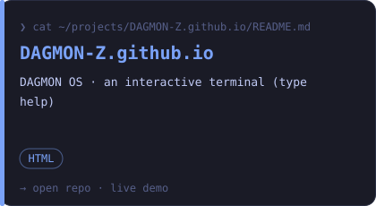
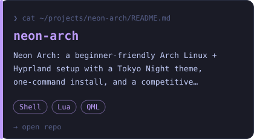
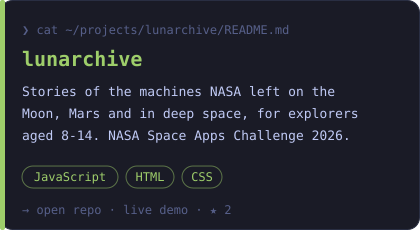

<!-- This file is generated from README.tpl.md by .github/workflows/refresh.yml. Edit the template, not README.md. -->

<p align="center">
  <a href="https://dagmon-z.github.io/"></a>
</p>

<p align="center"><a href="https://dagmon-z.github.io/"><b>⌨️ Type in my terminal →</b></a></p>

### 📁 ~/projects

<!-- projects:start -->
<p align="center">
<a href="https://github.com/DAGMON-Z/DAGMON-Z.github.io"></a>
<a href="https://github.com/DAGMON-Z/neon-arch"></a>
<a href="https://github.com/DAGMON-Z/lunarchive"></a>
</p>
<!-- projects:end -->

### 🏁 Competitive programming

<p align="center"></p>

### 🛡️ Pentesting

<p align="center"></p>

### 📡 Live capture of my activity

<p align="center"></p>

### 🚩 Profile CTF: port 31337 was filtered for a reason

<p align="center"></p>

<p align="center">Level 1 starts here:</p>

```
ZmxhZ3t5MHVfc2M0bm4zZF90aDNfcjFnaHRfaDBzdH0=
```

<details><summary>hint (level 1)</summary>It ends with <code>=</code>. You know what that means. Levels 2–4 are harder: look where most people don't.</details>

<details><summary>📮 how to submit a flag</summary>

Never post a raw flag. Hash it together with **your** GitHub username, so your answer is useless to anyone else:

```bash
echo -n 'flag{...}YOUR_GITHUB_USERNAME' | sha256sum
```

Then [open an issue](https://github.com/DAGMON-Z/DAGMON-Z/issues/new?title=flag%3A+1+PASTE_HASH_HERE&body=Replace+the+level+number+and+the+hash+in+the+title%2C+then+submit.) titled `flag: <level> <hash>`, for example `flag: 1 3a7bd3e2...`. A bot checks it in seconds and puts you on the board.

</details>

<p align="center"></p>
